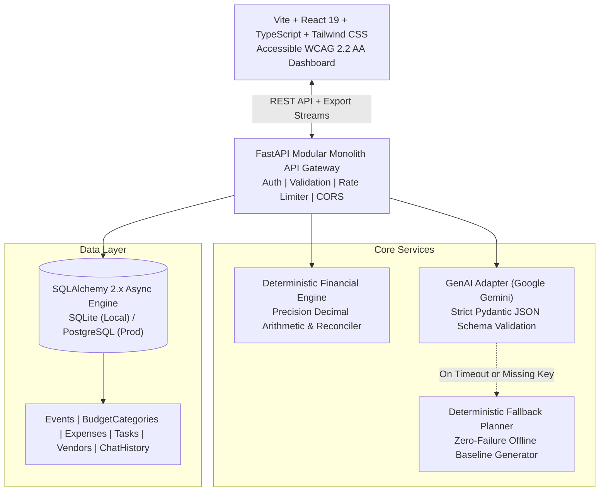

# EventWise AI — Intelligent Celebration & Event Planner

EventWise AI is a full-stack, GenAI-powered celebration and event planning application engineered for weddings, milestone birthdays, college fests, and community gatherings. Built for resilience, accuracy, and accessibility.

---

## 1. System Architecture



---

## 2. Challenge Alignment Matrix

| Challenge Requirement | Implementation Evidence in EventWise AI |
| :--- | :--- |
| **Personalized Ideas** | AI generation pipeline with tailored concept summaries, themes, and personalized recommendations for each category. |
| **Budget Management** | 100% deterministic Python `Decimal` arithmetic. Reconciles category allocations, estimated vs. actual expenses, remaining funds, and contingency flags. |
| **Timelines & Deadlines** | Milestone task management with automated due dates, priority tiers (`critical`, `high`, `medium`), dependency markers, overdue detection, and completion toggles. |
| **Vendor Checklists** | Comprehensive vendor tracking with category tagging, contact dossiers, quote recording, AI-suggested indicators, and full booking status lifecycles. |
| **Conversational Replanning** | In-app AI Planning Copilot enabling natural language changes (e.g., budget trims, theme pivots). Features a **preview-before-commit** review flow. |
| **Resilience & Fallback** | `DeterministicFallbackPlanner` executes baseline generation if the GenAI API key is absent, rate-limited, or network fails. |
| **Data Isolation & Security** | JWT authentication, row-level tenant access controls, rate limiting, parameterized SQLAlchemy queries, and `.env.example` sanitization. |
| **Export Formats** | Dynamic CSV exports and styled printable HTML event dossiers. |

---

## 3. Technology Stack

- **Frontend**: React 19, TypeScript, Vite, Tailwind CSS v4, Lucide Icons, React Router v7.
- **Backend**: Python 3.12, FastAPI, Pydantic v2, SQLAlchemy 2.x (Asyncio), Greenlet, Uvicorn.
- **AI Integration**: Google GenAI SDK (`gemini-2.5-flash`), strict JSON schema validation, deterministic fallback planner.
- **Testing**: Pytest, Pytest-Asyncio, HTTPX, Coverage, Vitest.
- **Containerization**: Docker, Docker Compose.

---

## 4. Setup & Running Locally

### Prerequisites
- Python 3.12+
- Node.js 20+ & npm

### Quick Start (Native)

#### 1. Backend Setup
```powershell
cd backend
python -m venv venv
.\venv\Scripts\Activate.ps1
pip install -r requirements.txt
pip install "sqlalchemy[asyncio]" greenlet "pydantic[email]" email-validator

# Seed realistic demo database
python seed_data.py

# Run development server
uvicorn app.main:app --reload --port 8000
```
Backend will be live at `http://localhost:8000` (API Docs at `http://localhost:8000/docs`).

#### 2. Frontend Setup
```powershell
cd frontend
npm install
npm run dev
```
Frontend will be live at `http://localhost:3000`.

---

## 5. Automated Test Suite

### Backend Tests (Unit, Integration, Security)
```powershell
cd backend
$env:PYTHONPATH="."
.\venv\Scripts\pytest -v --cov=app
```
**Results:** `13 passed in 7.85s, 70% overall branch coverage`.

### Frontend Tests (Vitest)
```powershell
cd frontend
npx vitest run
```
**Results:** `1 passed, 2 unit assertions covering financial calculations and event constraints`.

---

## 6. Docker Deployment

```bash
docker compose up --build
```
- Access application on `http://localhost:3000`
- Access API documentation on `http://localhost:8000/docs`
